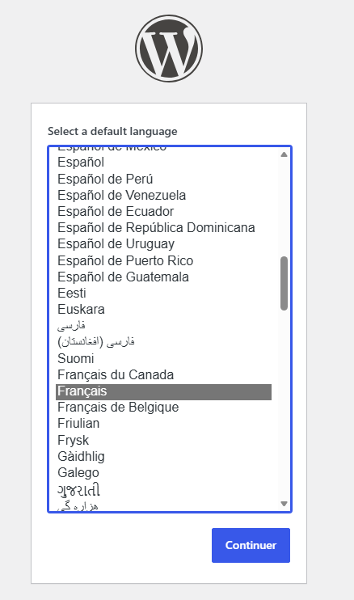
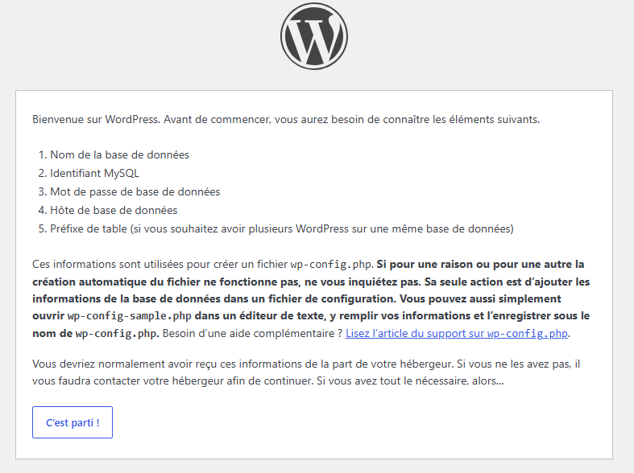
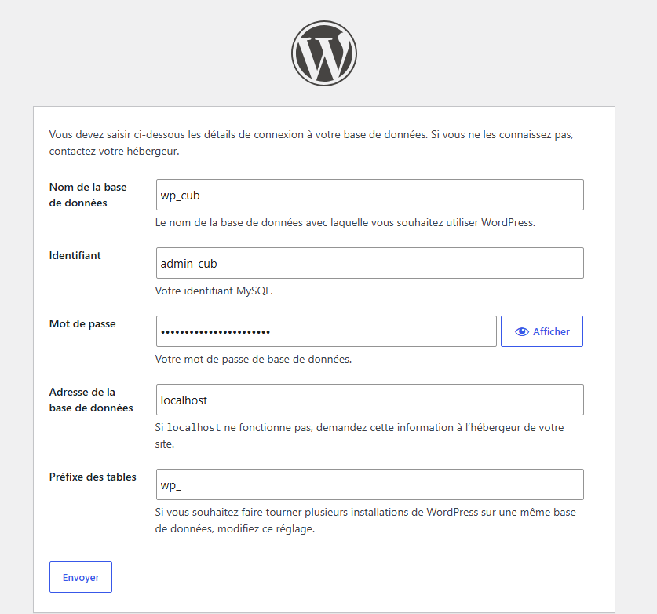
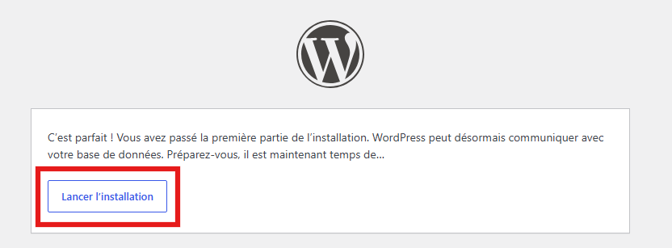
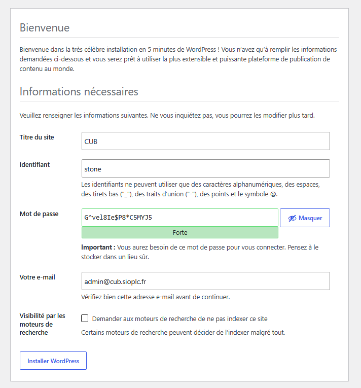

# Installation de WordPress sur Debian 13


---

## Informations

- **Auteur :** Louis MEDO
- **Date :** 15/10/2026
- **Domaine :** Exploitation Services

---

## 1. Sommaire

- [2. Contexte](#2-contexte)
- [3. Prérequis](#3-prerequis)
- [4. Préparation de la base de données](#4-preparation-de-la-base-de-donnees)
- [5. Configuration d'Apache (Multi-VHost)](#5-configuration-d-apache-multi-vhost)
- [6. Déploiement de WordPress](#6-deploiement-de-wordpress)

## 2. Contexte

Déploiement du CMS WordPress pour l'entreprise CUB sur une infrastructure Debian 13. Ce service s'intègre via une architecture LAMP avec une base de données MariaDB dédiée. Le serveur web Apache est configuré en mode multi-VirtualHost pour isoler et héberger spécifiquement l'URL `www0.dortmund.cub.sioplc.fr`.

## 3. Prérequis {#3-prerequis}

Avant de commencer, vérifier que les éléments suivants sont disponibles :

- un serveur Debian 13 ;
- la pile LAMP installée, notamment Apache, PHP-FPM 8.4 et MariaDB ;
- le nom `www0.dortmund.cub.sioplc.fr` déclaré sur les serveurs DNS faisant autorité ;
- les paquets `wget` et `unzip`.

Installer les outils manquants si nécessaire :

```bash
sudo apt update
sudo apt install -y wget unzip
```

## 4. Préparation de la base de données {#4-preparation-de-la-base-de-donnees}

3.1. **Création de la base et de l'utilisateur MariaDB.** Initialisation de la structure de base de données requise par WordPress.

```bash
# Connexion à MariaDB
mysql -u root -p
```

> [!info] Mot de passe
> Le mot de passe root de MariaDB permettant d'effectuer ces opérations doit être récupéré depuis le coffre-fort Bitwarden.

```sql
CREATE DATABASE wp_cub;
CREATE USER 'admin_cub'@'localhost' IDENTIFIED BY 'ChangezMoiSvp';
GRANT ALL PRIVILEGES ON wp_cub.* TO 'admin_cub'@'localhost';
FLUSH PRIVILEGES;
```

* `CREATE DATABASE` : Instancie une nouvelle base de données nommée `wp_cub`.
* `CREATE USER` : Crée l'utilisateur d'administration local avec son mot de passe.
* `GRANT ALL PRIVILEGES` : Assigne les droits totaux à cet utilisateur sur la base `wp_cub`.
* `FLUSH PRIVILEGES` : Actualise les droits en mémoire pour activer immédiatement les nouveaux privilèges.

## 5. Configuration d'Apache {#5-configuration-d-apache-multi-vhost}

4.1. **Création du Virtual Host.** Définition de la configuration pour isoler le site web de l'entreprise.

```bash
sudoedit /etc/apache2/sites-available/www0.dortmund.cub.sioplc.fr.conf
```

```conf
<VirtualHost *:80>
    ServerName www0.dortmund.cub.sioplc.fr
    DocumentRoot /var/www/www0.dortmund.cub.sioplc.fr

    <Directory /var/www/www0.dortmund.cub.sioplc.fr>
        Options FollowSymLinks
        AllowOverride All
        Require all granted
    </Directory>

    ErrorLog ${APACHE_LOG_DIR}/www0_error.log
    CustomLog ${APACHE_LOG_DIR}/www0_access.log combined
</VirtualHost>
```

* `<VirtualHost *:80>` : Déclare un bloc de configuration pour un hôte écoutant sur le port HTTP 80.
* `ServerName` : Définit le nom de domaine ciblé par ce VHost.
* `DocumentRoot` : Cible le dossier racine spécifique contenant les fichiers du site.
* `ErrorLog` / `CustomLog` : Configure des journaux d'erreurs et d'accès indépendants pour ce VHost.

> [!info] Nom de domaine
> Le nom de domaine doit être déclaré sur les serveurs DNS faisant autorité afin que les clients puisse résoudre ce nom.

4.2. **Activation du Virtual Host.** Application de la configuration au serveur web.

```bash
sudo a2ensite www0.dortmund.cub.sioplc.fr.conf
sudo apache2ctl configtest
sudo systemctl reload apache2
```

* `a2ensite` : Commande Debian activant le site en créant un lien symbolique vers `sites-enabled`.
* `apache2ctl configtest` : Vérifie la syntaxe de la configuration Apache avant son application.
* `systemctl reload` : Recharge la configuration du service Apache à chaud sans interrompre les connexions actives.

## 6. Déploiement de WordPress {#6-deploiement-de-wordpress}

5.1. **Téléchargement et installation.** Récupération de l'archive source.

```bash
cd /tmp
wget https://wordpress.org/latest.zip
sudo mkdir -p /var/www/www0.dortmund.cub.sioplc.fr
sudo unzip latest.zip -d /var/www/www0.dortmund.cub.sioplc.fr
sudo mv /var/www/www0.dortmund.cub.sioplc.fr/wordpress/* /var/www/www0.dortmund.cub.sioplc.fr/
sudo rm -Rf /var/www/www0.dortmund.cub.sioplc.fr/wordpress/
```

* `wget` : Télécharge le fichier `latest.zip` depuis l'URL officielle.
* `mkdir -p` : Crée le DocumentRoot s'il n'existe pas encore.
* `unzip` : Extrait l'archive dans le DocumentRoot du VHost.
* `mv` : Remonte le contenu du sous-dossier `wordpress/` généré par l'archive directement à la racine du VHost.
* `rm -rf` : Supprime le sous-dossier `wordpress/` devenu vide après le déplacement des fichiers.

5.2. **Attribution des permissions.** Sécurisation de l'arborescence des fichiers web.

```bash
sudo chown -R www-data:www-data /var/www/www0.dortmund.cub.sioplc.fr/
sudo find /var/www/www0.dortmund.cub.sioplc.fr/ -type d -exec chmod 755 {} \;
sudo find /var/www/www0.dortmund.cub.sioplc.fr/ -type f -exec chmod 644 {} \;
```

* `chown -R` : Assigne récursivement la propriété des fichiers et répertoires à l'utilisateur `www-data` (processus Apache).
* `find ... -type d -exec chmod 755` : Applique les droits `755` (lecture/exécution globales, écriture au propriétaire) uniquement pour les dossiers.
* `find ... -type f -exec chmod 644` : Applique les droits `644` (lecture globale, écriture au propriétaire) uniquement pour les fichiers.

5.3. **Choix de la langue.** Accéder à [www0.dortmund.cub.sioplc.fr](http://www0.dortmund.cub.sioplc.fr/). Sélectionner le français pour définir la localisation du site et de l'interface d'administration.



5.4. **Validation des prérequis.** Étape informative confirmant la possession des identifiants MariaDB, nécessaires à la génération automatique du fichier `wp-config.php` par l'installeur.



5.5. **Configuration de la base de données.** Interfacer le CMS avec MariaDB.



* **Nom de la base / Identifiant :** `wp_cub` / `admin_cub` (Application stricte du principe de moindre privilège avec un compte dédié).
* **Adresse :** `localhost` (Maintient le flux SQL en local, évitant l'exposition réseau du port 3306).
* **Préfixe des tables :** Remplacer le `wp_` par défaut (ex: `cub_`) pour mitiger les attaques par injection SQL automatisées.

5.6. **Initialisation de la base.** Valide l'authentification auprès de MariaDB et lance le script de création du schéma de base de données.



5.7. **Création du compte administrateur.**



* **Identifiant :** `stone` (**Bonne pratique :** Proscrire l'utilisateur `admin` pour neutraliser les attaques par force brute standard).
* **Mot de passe :** Utiliser une chaîne à haute entropie et la stocker dans Bitwarden.
* **E-mail :** `admin@cub.sioplc.fr` (Indispensable pour le recouvrement de compte et les alertes de sécurité).
* **Visibilité par les moteurs de recherche :** Laisser décoché en production. À cocher uniquement pour isoler un environnement de test/pré-production de l'indexation SEO.
