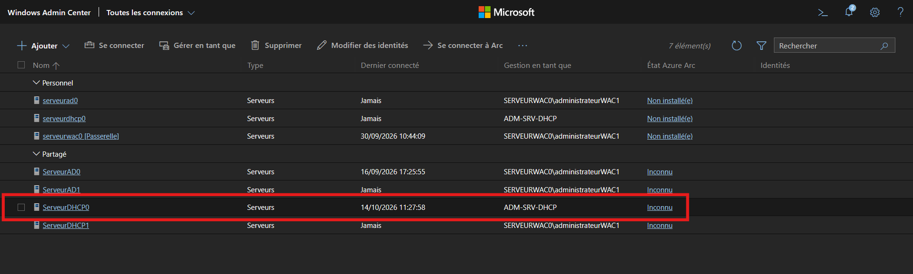
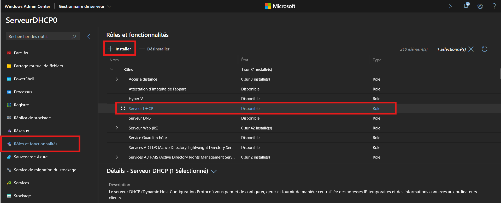
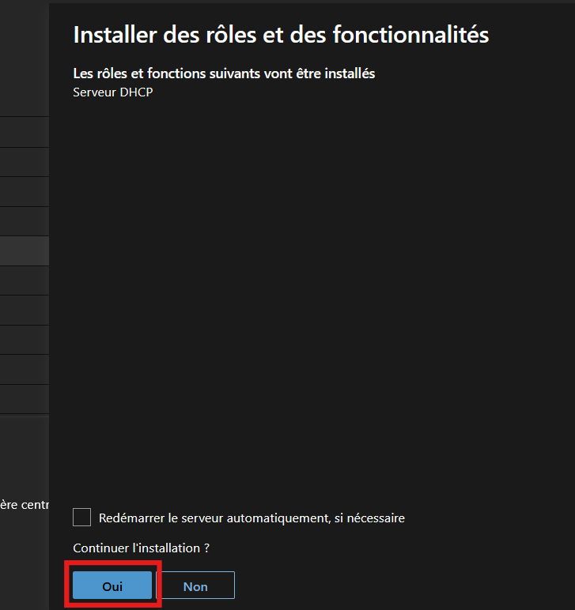
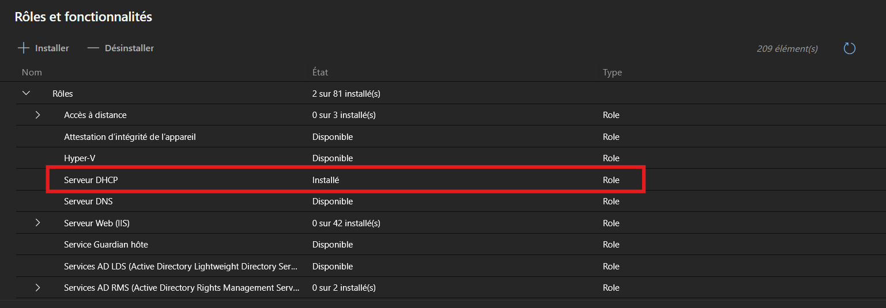

# Installation du rôle DHCP


---

## Informations

- **Auteur :** Louis MEDO
- **Date :** 18/10/2026
- **Domaine :** Administration Windows

---

## 1. Sommaire

- [1. Sommaire](#1-sommaire)
- [2. Contexte](#2-contexte)
- [3. Installation via WAC](#3-installation-via-wac)
- [4. Installation via Powershell](#4-installation-via-powershell)

## 2. Contexte

Cette procédure décrit les étapes de déploiement permettant d'installer le rôle Serveur DHCP sur un serveur distant. Elle détaille deux méthodes d'installation : via l'interface web de gestion Windows Admin Center (WAC) et en ligne de commande via PowerShell. Le service DHCP est essentiel pour automatiser l'attribution des adresses IP et fluidifier les flux d'accès au sein de l'infrastructure CUB.

## 3. Installation via WAC

3.1. **Connexion à l'interface.** Se connecter à l'interface WAC en accédant à l'URL `https://192.168.4.5` depuis un navigateur.

3.2. **Sélection du serveur cible.** Sélectionner le serveur distant sur lequel le rôle DHCP doit être déployé.



3.3. **Sélection du rôle.** Aller dans le menu **Rôles et fonctionnalités**, cocher l'option **Serveur DHCP**, puis cliquer sur le bouton **Installer**.



3.4. **Confirmation de l'installation.** Une fenêtre contextuelle demande de confirmer l'action. Cliquer sur **Oui** pour lancer le processus.



3.5. **Vérification du statut.** Après un certain temps, vérifier dans la liste que l'état de la ligne **Serveur DHCP** est passé à **Installé**.



## 4. Installation via Powershell

4.1. **Lancement de l'invite de commandes.** Ouvrir une console PowerShell avec les privilèges d'administrateur sur le serveur.

4.2. **Installation du rôle.** Exécuter la cmdlet suivante pour installer le rôle DHCP ainsi que ses outils d'administration.

```Powershell
Install-WindowsFeature -Name DHCP -IncludeManagementTools
```

L'option -IncludeManagementTools permet d'installer les outils RSAT nécessaires à la configuration (console, modules).

4.3. **Vérification de l'installation.** Une fois l'exécution terminée, exécuter la commande suivante pour confirmer que le rôle est bien présent (l'état "Install State" doit indiquer "Installed").

```Powershell
Get-WindowsFeature -Name DHCP
```
