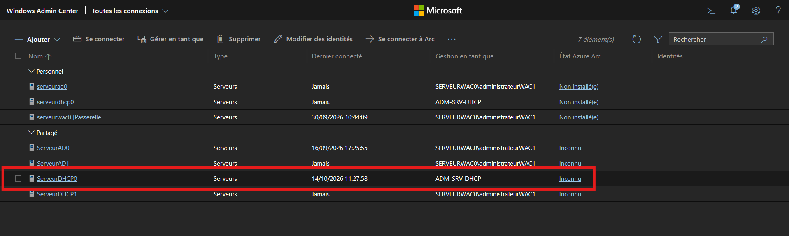
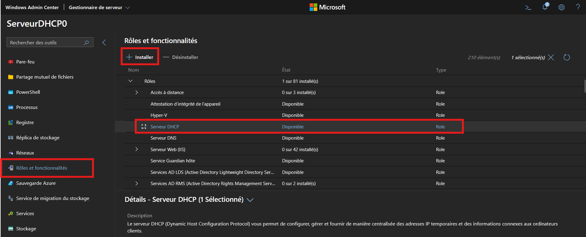
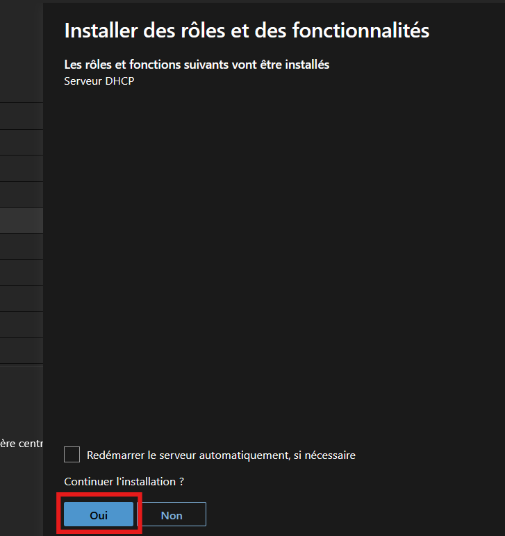
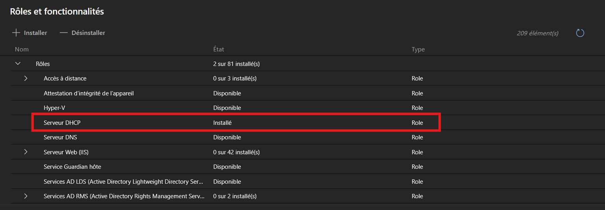

# Installation du rôle DHCP depuis WAC

---

## Informations

- **Auteur :** Louis MEDO
- **Date :** 18/10/2026
- **Domaine :** Administration Windows

---

## 1. Sommaire

- [1. Sommaire](#1-sommaire)
- [2. Contexte](#2-contexte)
- [3. Procédure d'installation](#3-procedure-dinstallation)

## 2. Contexte

Cette procédure décrit les étapes de déploiement permettant d'installer le rôle Serveur DHCP sur un serveur distant via l'interface web de gestion Windows Admin Center (WAC). Le service DHCP est essentiel pour automatiser l'attribution des adresses IP et fluidifier les flux d'accès au sein de l'infrastructure CUB.

## 3. Procédure d'installation {#3-procedure-dinstallation}

3.1. **Connexion à l'interface.** Se connecter à l'interface WAC en accédant à l'URL `https://192.168.4.5` depuis un navigateur.

3.2. **Sélection du serveur cible.** Sélectionner le serveur distant sur lequel le rôle DHCP doit être déployé.

3.3. **Sélection du rôle.** Aller dans le menu **Rôles et fonctionnalités**, cocher l'option **Serveur DHCP**, puis cliquer sur le bouton **Installer**.

3.4. **Confirmation de l'installation.** Une fenêtre contextuelle demande de confirmer l'action. Cliquer sur **Oui** pour lancer le processus.

3.5. **Vérification du statut.** Après un certain temps, vérifier dans la liste que l'état de la ligne **Serveur DHCP** est passé à **Installé**.

