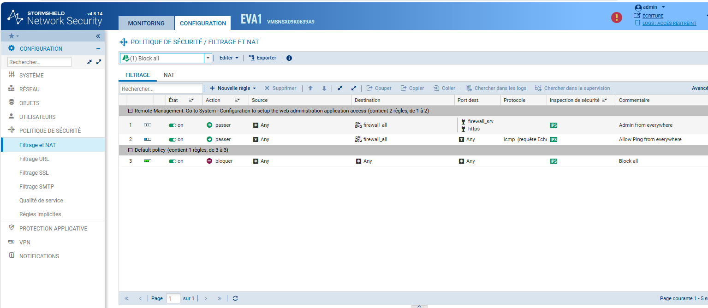
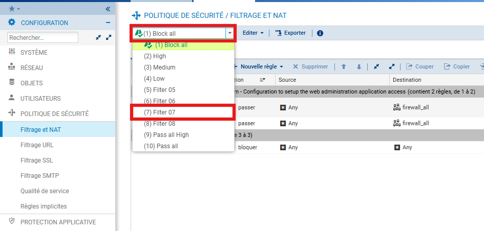
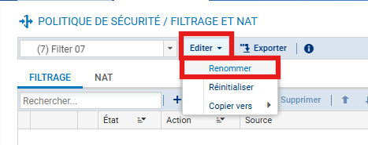
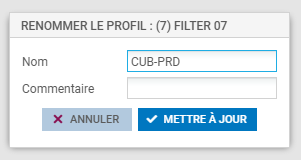

# Créer un profil de filtrage sur Stormshield

---

## Informations

- **Auteur :** Louis MEDO
- **Date :** 14/11/2026
- **Domaine :** Cybersécurité

---

## 1. Sommaire

- [1. Sommaire](#1-sommaire)
- [2. Contexte](#2-contexte)
- [3. Configuration du profil de filtrage](#3-configuration-du-profil-de-filtrage)

## 2. Contexte

Mise en place et isolation d'un nouveau profil de politique de sécurité sur l'appliance Stormshield. Cette procédure standardise la création de profils dédiés par environnement (Production, Test) en s'affranchissant des configurations par défaut globales, garantissant ainsi une segmentation rigoureuse et une meilleure maintenabilité des règles de filtrage du projet CUB.

## 3. Configuration du profil de filtrage

3.1. **Accès au module de politique de sécurité.** Naviguer dans l'interface d'administration vers la section dédiée aux règles de pare-feu et de traduction d'adresses.

- `Chemin d'accès` : Configuration > Politique de sécurité > Filtrage et NAT.

3.2. **Sélection d'un profil personnalisable.** Choisir un emplacement de profil non utilisé pour y instancier la nouvelle politique.

> [!warning] Restriction d'usage des profils par défaut
> Il est proscrit d'utiliser les profils système par défaut tels que `Block all` ou `Pass all`. Sélectionnez impérativement un profil libre (par exemple, le profil `(7) Filter 07`).

- `Action` : Ouvrir le menu déroulant des profils en haut à gauche et sélectionner le profil cible.

3.3. **Initialisation du renommage.** Basculer le profil sélectionné en mode édition pour modifier ses métadonnées.

- `Action` : Cliquer sur le menu déroulant **Editer** puis sélectionner **Renommer**.

3.4. **Application de la convention de nommage.** Assigner un identifiant explicite respectant la nomenclature d'environnement.

> [!tip] Convention de nommage
> Donnez un nom clair identifiant immédiatement le périmètre et l'environnement. Utilisez `CUB-PRD` pour la production. Cela permettra d'assurer une cohérence avec le profil `CUB-TEST` lors des phases de validation.

- `Nom` : `CUB-PRD`
- `Action` : Saisir le nom dans le champ correspondant puis cliquer sur **METTRE À JOUR**.

