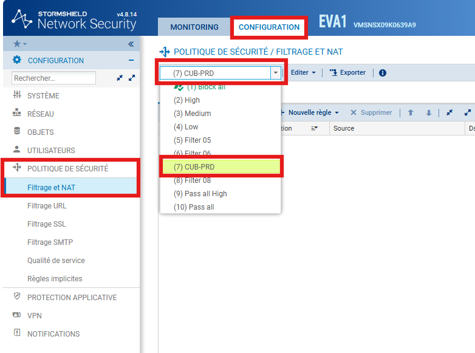
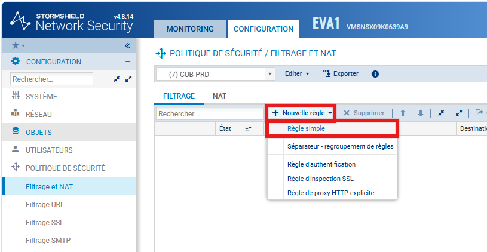
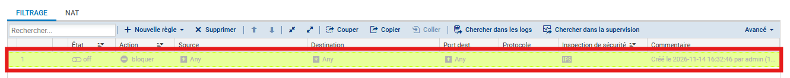
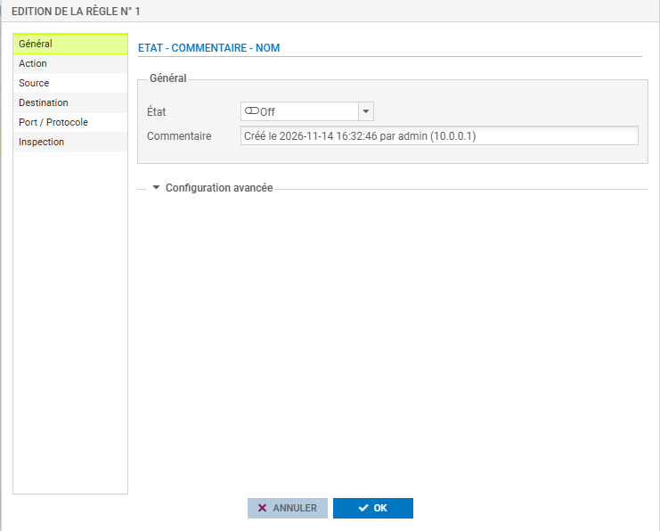
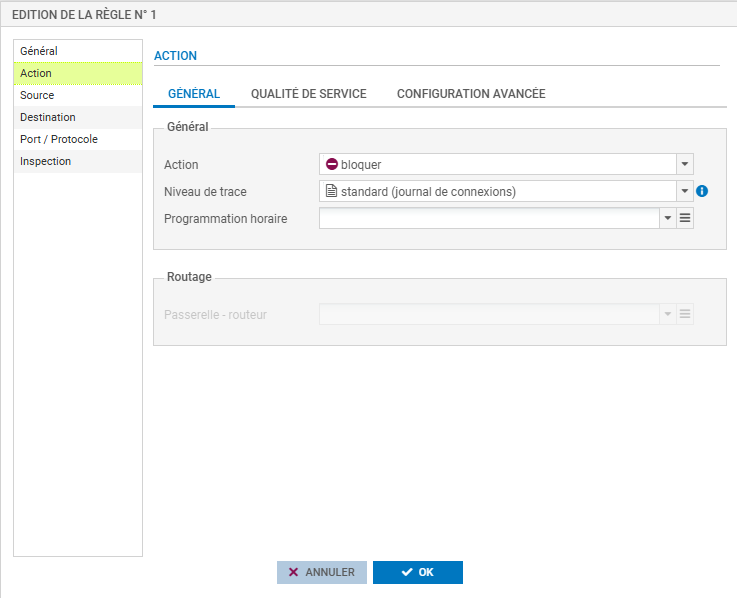
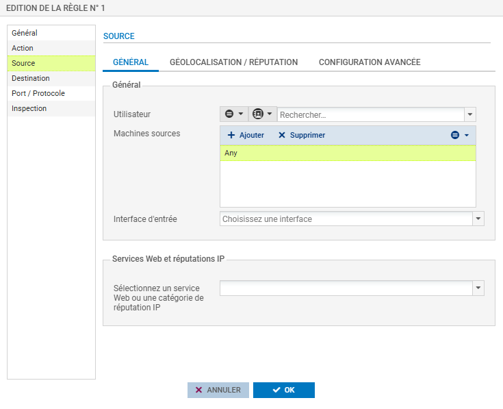
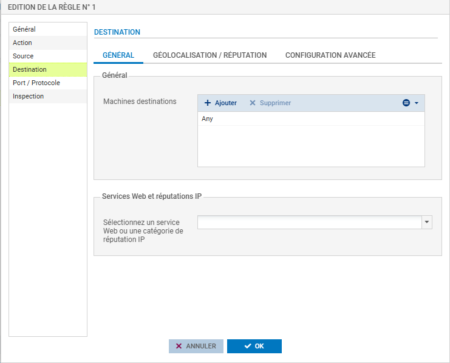
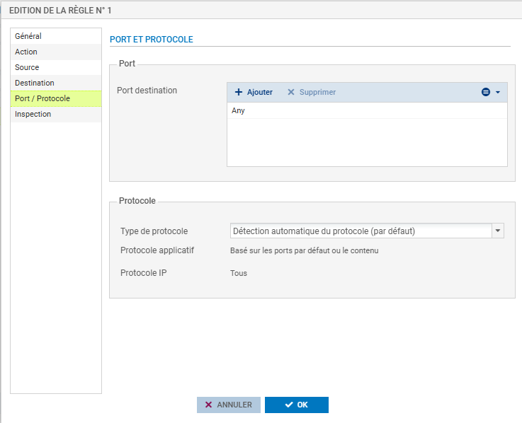
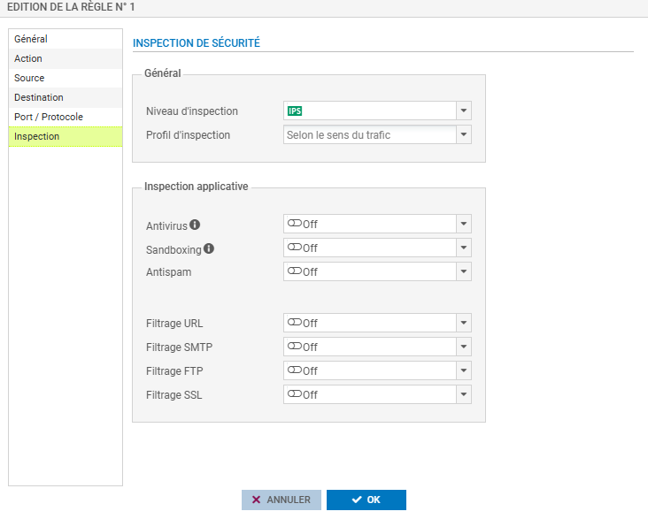

# Créer des règles de filtrage sur Stormshield

---

## Informations

- **Auteur :** Louis MEDO
- **Date :** 14/11/2026
- **Domaine :** Cybersécurité

---

## 1. Sommaire

- [1. Sommaire](#1-sommaire)
- [2. Contexte](#2-contexte)
- [3. Sélection du profil de sécurité](#3-selection-du-profil-de-securite)
- [4. Création et édition de la règle](#4-creation-et-edition-de-la-regle)
- [5. Configuration Générale](#5-configuration-generale)
- [6. Configuration de l'Action](#6-configuration-de-laction)
- [7. Configuration de la Source et Destination](#7-configuration-de-la-source-et-destination)
- [8. Configuration de l'Inspection de sécurité](#8-configuration-de-linspection-de-securite)

## 2. Contexte

Déploiement et configuration des Access Control Lists (ACL) sur l'appliance de sécurité Stormshield. Cette procédure standardisée permet de définir la politique de sécurité réseau, de segmenter les flux inter-VLAN et de protéger les services exposés via l'application de profils d'inspection de sécurité de niveau 7 (IPS/IDS) tout en garantissant la traçabilité des accès.

## 3. Sélection du profil de sécurité {#3-selection-du-profil-de-securite}

3.1. **Accéder au module de politique réseau.** Dans l'arborescence de navigation gauche, sélectionnez l'onglet **Configuration**.

3.2. **Ouvrir le menu de filtrage.** Déployez le menu **Politique de sécurité** puis cliquez sur **Filtrage et NAT**.

3.3. **Sélectionner le profil cible.** Dans la liste déroulante supérieure, choisissez le profil de sécurité sur lequel vous souhaitez créer l'ACL (par exemple, le profil non par défaut `(7) CUB-PRD`).

> [!warning] Risque de coupure réseau
> Soyez vigilant quant au profil actif lors de vos modifications. L'édition d'une politique appliquée en production peut entraîner des interruptions de service si l'ordonnancement de la matrice n'est pas respecté.

## 4. Création et édition de la règle {#4-creation-et-edition-de-la-regle}

4.1. **Instancier la règle.** Dans l'onglet **Filtrage**, cliquez sur le bouton déroulant `+ Nouvelle règle` puis sélectionnez `Règle simple`.

4.2. **Ouvrir les propriétés avancées.** Dans la matrice, effectuez un double-clic sur la nouvelle ligne créée pour accéder à l'interface complète d'édition de la règle.

## 5. Configuration Générale {#5-configuration-generale}

5.1. **Définir le statut et la nomenclature.** Dans la section **Général** du panneau d'édition :

- **État** : Sélectionnez `On` pour activer la règle ou `Off` pour la conserver sous forme de brouillon/désactivée.
- **Commentaire** : Renseignez une description claire de l'utilité métier de la règle. (Exemple : `[SVC] Autoriser flux HTTPS vers Nginx Proxy DMZ`).

## 6. Configuration de l'Action

6.1. **Paramétrer le traitement du paquet.** Allez dans la section **Action**, sous-onglet **Général** :

- **Action** : Choisissez la disposition à appliquer au flux parmi `bloquer` (Drop), `passer` (Accept), `déchiffrer` ou `reinit. TCP/UDP` (Reject).
- **Niveau de trace** : Configurez la profondeur de la journalisation. Choisissez `standard (journal de connexions)` pour un logging classique, ou `avancé (journal de connexions et journal de filtrage)` pour du troubleshooting.

## 7. Configuration de la Source et Destination

> [!tip] Règle du moindre privilège
> Remplacez systématiquement l'objet `Any` par des objets réseau spécifiques (IP, Sous-réseaux ou Groupes) strictement nécessaires à la communication du service, sans recourir aux adresses RFC1918 depuis des zones non sécurisées.

7.1. **Déclarer l'origine.** Naviguez vers la section **Source** :

- **Machines sources** : Ajoutez le ou les objets réseau concernés, par défaut défini sur `Any`.
- **Interface d'entrée** : (Optionnel) Sélectionnez une interface de pare-feu spécifique pour verrouiller physiquement la règle.
- **Services Web et réputations IP** : (Optionnel) Appliquez des filtres dynamiques pré-catégorisés (ex: `suspect`, `tor exit node`, `bad`).

7.2. **Déclarer la cible.** Naviguez vers la section **Destination** et reproduisez la logique précédente en définissant la `Machine destination` (objet IP ou alias) et potentiellement le port cible (Section Port / Protocole).

7.3. **Déclarer le protocole de la cible.** Naviguez vers la section **Port / Protocole** pour finaliser la logique de routage :

- **Port destination** : Spécifiez le port d'écoute du service ciblé en cliquant sur `+ Ajouter`. Par défaut, la valeur est `Any`.
- **Type de protocole** : Sélectionnez la couche de transport appropriée (ex : `Protocole IP`).
- **Protocole IP** : Définissez le protocole de communication spécifique. Le menu déroulant ou la barre de recherche permet de filtrer rapidement les protocoles standardisés tels que `icmp`, `tcp`, ou `udp`.

## 8. Configuration de l'Inspection de sécurité {#8-configuration-de-linspection-de-securite}

8.1.  **Activer le filtrage de couche 7.** Dans la section **Inspection** :

- **Niveau d'inspection** : Définissez le moteur de détection : `IPS` (Bloque activement les signatures d'attaques), `IDS` (Alerte uniquement) ou Firewall.
- **Profil d'inspection** : Sélectionnez le comportement d'analyse, généralement `Selon le sens du trafic` par défaut, ou forcez un profil d'inspection spécifique (ex: `IPS_00`, `IPS_01`, etc.) selon vos tables de pare-feu et listes personnalisées (ex: `LISTE_BOTNET`).
- **Inspection applicative** : Activez au besoin les modules de contrôle profond tels que `Antivirus`, `Sandboxing`, `Antispam`, `Filtrage URL` ou `Filtrage SSL` en basculant leur commutateur sur `On` ou `Off`.

> [!info] Utilisation de l'IPS
> Le niveau d'inspection `IPS` est recommandé sur l'intégralité des flux à destination ou en provenance des zones publiques (WAN) afin d'assurer l'intégrité de l'infrastructure exposée.
